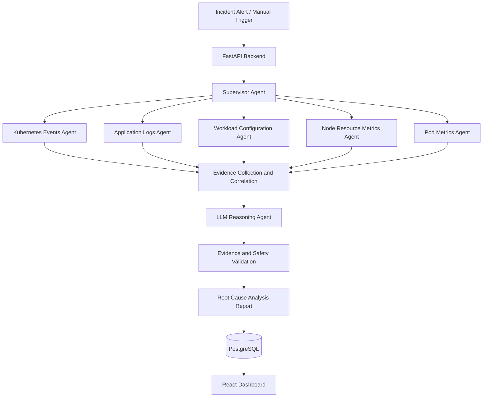

# OpsLens AI

### Multi-Agent AIOps Platform for Kubernetes Incident Investigation and Root-Cause Analysis

OpsLens AI is a proposed multi-agent infrastructure observability platform designed to help DevOps and Site Reliability Engineering (SRE) teams investigate Kubernetes failures.

The system uses specialized agents to collect and analyze Kubernetes events, application logs, workload configurations, and infrastructure metrics. A Supervisor Agent coordinates the investigation, correlates evidence, and passes structured findings to an LLM Reasoning Agent to generate explainable Root Cause Analysis (RCA) reports.

**Project Status:** Under Development

## Overview

Modern cloud-native applications generate large amounts of operational data across Kubernetes clusters, including logs, events, resource metrics, and configuration changes.

Identifying the root cause of an incident requires engineers to correlate information across multiple components, distinguish symptoms from underlying failures, and interpret complex infrastructure behavior.

OpsLens AI aims to automate this investigation process through a supervisor-driven multi-agent architecture that combines deterministic evidence collection with Generative AI reasoning.

## Key Features

### 1. Multi-Agent Infrastructure Investigation

The platform is designed around seven specialized agents:

- **Kubernetes Events Agent:** Analyzes pod lifecycle events, scheduling failures, container restarts, and health probe failures.
- **Application Logs Agent:** Inspects container logs to identify application errors, exceptions, and startup failures.
- **Workload Configuration Agent:** Examines deployments, services, configuration settings, selectors, and health probes.
- **Node Resource Metrics Agent:** Analyzes CPU, memory utilization, and resource pressure across Kubernetes nodes.
- **Pod Metrics Agent:** Detects unusual resource consumption and investigates pod-level anomalies using statistical techniques and potentially LSTM-based models.
- **Supervisor Agent:** Coordinates specialized agents, consolidates evidence, and identifies relationships between infrastructure signals.
- **LLM Reasoning Agent:** Uses structured evidence to produce root-cause explanations, incident summaries, and recommended corrective actions.

### 2. Supervisor-Driven Agent Orchestration

A centralized Supervisor Agent manages the investigation pipeline.

Each specialized agent independently analyzes its assigned infrastructure signals and returns structured findings.

The Supervisor aggregates these outputs, filters irrelevant observations, correlates related failures, and prepares an evidence-based context for the reasoning layer.

This approach separates infrastructure data collection from LLM reasoning.

### 3. Kubernetes Infrastructure Monitoring

OpsLens AI is designed to investigate common Kubernetes operational issues, including:

- Pod crashes and repeated container restarts.
- `CrashLoopBackOff` and `OOMKilled` conditions.
- CPU and memory resource exhaustion.
- Misconfigured readiness and liveness probes.
- Failed deployments and image pull errors.
- Service connectivity and configuration issues.

### 4. AI-Powered Root Cause Analysis

The LLM Reasoning Agent receives structured technical evidence rather than unrestricted raw infrastructure data.

It generates an RCA report containing:

- Incident description and affected resources.
- Most likely root cause.
- Supporting logs, events, and metrics.
- Related infrastructure anomalies.
- Recommended diagnostic and corrective actions.
- Validation steps for engineers.

### 5. Infrastructure Anomaly Detection

The planned anomaly detection module examines node and pod resource utilization to identify unexpected operational behavior.

The implementation will initially use statistical baselines and threshold-based approaches, with LSTM-based time-series anomaly detection evaluated as an extension.

### 6. Incident Dashboard and History

A React-based dashboard is planned to provide a centralized interface for reviewing:

- Kubernetes incident summaries.
- Investigation status and agent findings.
- Infrastructure metrics.
- Root-cause reports.
- Historical incidents and recurring failures.

Incident records and investigation results will be stored in PostgreSQL.

### 7. Secure, Read-Only Investigation

The platform follows a human-in-the-loop investigation model.

Specialized agents use scoped, read-only Kubernetes permissions. The LLM is not permitted to execute arbitrary commands or modify infrastructure resources.

Generated remediation recommendations require engineer review before execution.

## System Architecture



## Investigation Workflow

**Step 1 — Incident Detection**

An incident alert is received, or an engineer initiates an investigation for a specific Kubernetes workload.

**Step 2 — Evidence Collection**

The system collects Kubernetes events, container logs, workload configurations, and infrastructure metrics.

**Step 3 — Specialized Agent Analysis**

Each worker agent independently examines its assigned evidence and produces structured technical findings.

**Step 4 — Evidence Correlation**

The Supervisor Agent combines the findings, correlates observations using timestamps and resource identifiers, and identifies the most relevant failure signals.

**Step 5 — LLM-Based Reasoning**

The Reasoning Agent uses the consolidated evidence to generate a root-cause hypothesis and supporting explanation.

**Step 6 — Validation and Reporting**

The system validates the report structure, checks evidence references, and presents the final findings for engineer review.

**Step 7 — Incident History**

Investigation results are persisted for future reference and analysis.

## Technology Stack

| Component | Technology |
|---|---|
| Programming Language | Python |
| Backend Framework | FastAPI |
| Agent Architecture | Supervisor–Worker Multi-Agent System |
| Generative AI | Gemini / OpenAI API |
| Kubernetes Integration | Kubernetes Python Client |
| Containerization | Docker |
| Container Orchestration | Kubernetes |
| Monitoring | Prometheus, Kubernetes Metrics API |
| Anomaly Detection | Statistical Analysis, LSTM |
| Database | PostgreSQL |
| Frontend | React, TypeScript, Tailwind CSS |
| Testing | Pytest |
| CI/CD | GitHub Actions |

## Project Structure

```text
opslens-ai/
├── backend/
│   ├── app/
│   │   ├── agents/
│   │   │   ├── supervisor/
│   │   │   ├── kubernetes_events/
│   │   │   ├── application_logs/
│   │   │   ├── workload_config/
│   │   │   ├── node_metrics/
│   │   │   ├── pod_metrics/
│   │   │   └── llm_reasoning/
│   │   ├── api/
│   │   ├── collectors/
│   │   ├── core/
│   │   ├── models/
│   │   ├── services/
│   │   └── security/
│   └── tests/
├── frontend/
├── infrastructure/
│   ├── docker/
│   └── kubernetes/
├── scenarios/
├── knowledge_base/
│   └── runbooks/
├── docs/
├── .github/
│   └── workflows/
└── README.md
```

*The structure above represents the proposed organization of the implementation.*

## Incident Scenarios

The project will be evaluated against controlled Kubernetes failure scenarios.

| Scenario | Expected Investigation |
|---|---|
| CrashLoopBackOff | Identify application startup errors and container restart patterns |
| OOMKilled | Correlate memory limits, pod metrics, and container termination events |
| Readiness Probe Failure | Examine probe configuration and application health |
| Service Selector Mismatch | Identify inconsistencies between service selectors and pod labels |
| ImagePullBackOff | Examine image references and image retrieval failures |
| CPU Saturation | Correlate resource usage with workload degradation |

## Evaluation Metrics

The system will be assessed using:

- **Root-Cause Accuracy:** Percentage of incidents where the system correctly identifies the known failure.
- **Evidence Traceability:** Whether RCA conclusions reference relevant operational evidence.
- **Investigation Latency:** Time required to generate an incident analysis.
- **Reliability:** System behavior when observability tools or LLM services are unavailable.
- **Security:** Enforcement of read-only Kubernetes permissions and safe AI tool usage.

## Development Roadmap

- [ ] Set up FastAPI backend and Kubernetes test environment.
- [ ] Implement Kubernetes event and application log collectors.
- [ ] Develop workload configuration and resource metrics agents.
- [ ] Implement Supervisor Agent and evidence correlation.
- [ ] Integrate Gemini or OpenAI for structured RCA generation.
- [ ] Introduce security controls and evidence validation.
- [ ] Build React dashboard and PostgreSQL incident history.
- [ ] Add fault injection scenarios and automated tests.
- [ ] Configure Docker-based development and GitHub Actions CI/CD.
- [ ] Evaluate LSTM-based anomaly detection against simpler approaches.

## Security Considerations

- Use least-privilege Kubernetes RBAC permissions.
- Restrict AI agents to approved read-only operations.
- Treat logs, external inputs, and collected evidence as untrusted data.
- Never execute LLM-generated infrastructure commands automatically.
- Protect API credentials and sensitive configuration values.
- Redact sensitive information before transmitting evidence to external LLM services.
- Require engineer validation before taking remediation actions.

## Inspiration and Attribution

OpsLens AI is inspired by the open-source [OPSLENS-AI project by ahmedadel248](https://github.com/ahmedadel248/OPSLENS-AI).

The proposed implementation draws architectural inspiration from its specialized infrastructure agents, Supervisor-driven evidence correlation, and separation between deterministic data collection and LLM-based root-cause reasoning.

This project additionally proposes a React-based dashboard, persistent incident history, reproducible Kubernetes failure scenarios, and structured evaluation of investigation quality.

Any reuse of source code from the original repository will be subject to its applicable license terms.

## License

License to be determined before public distribution.
